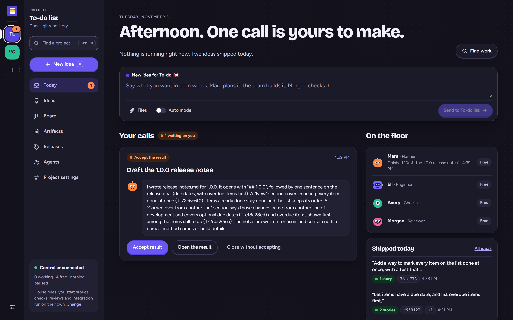
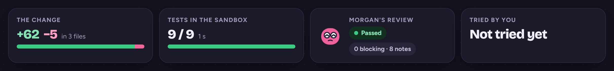
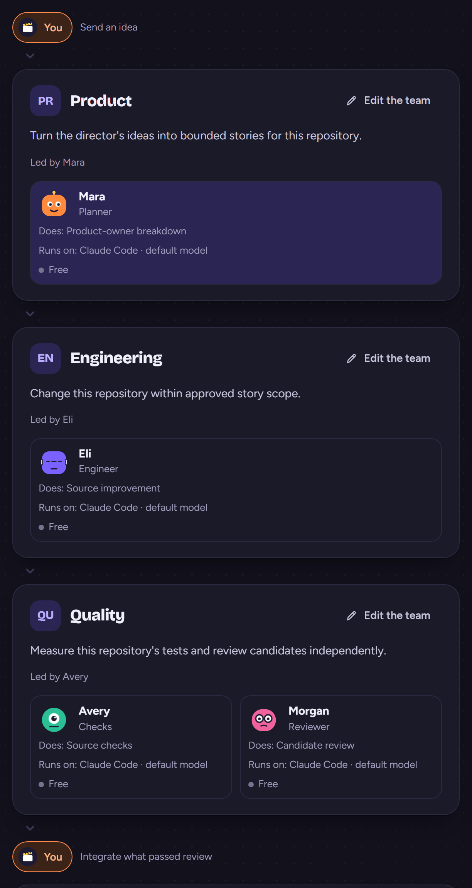
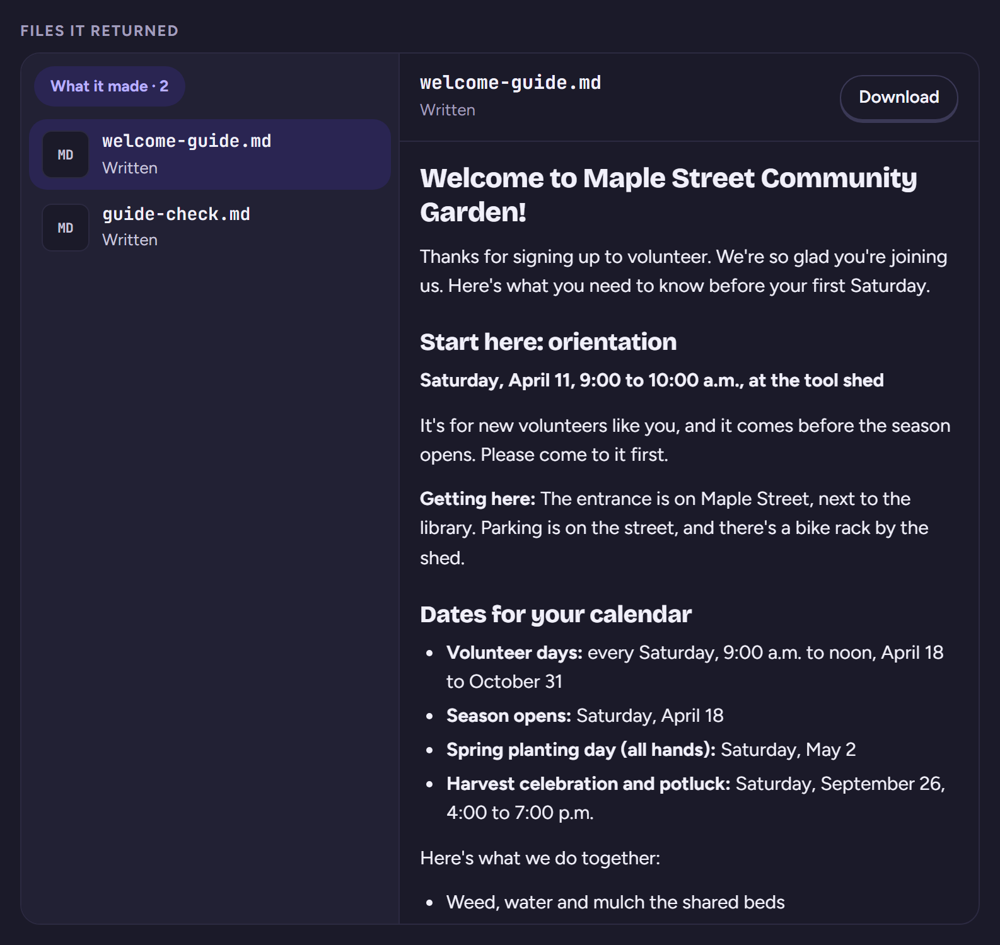
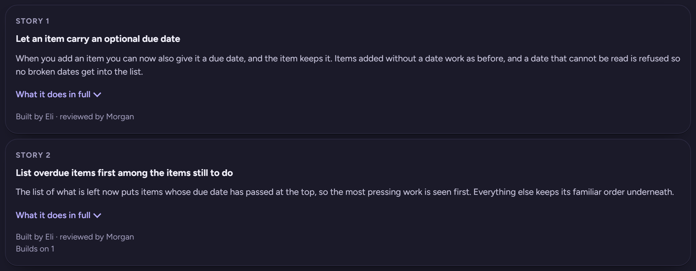
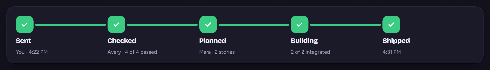
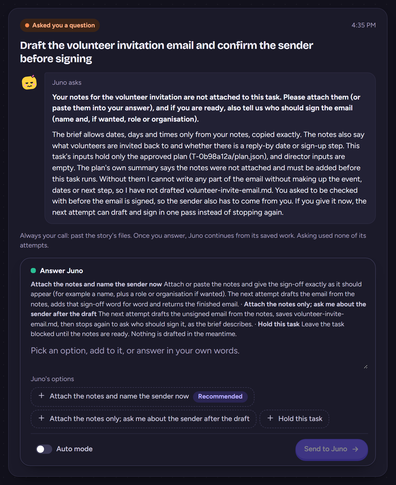
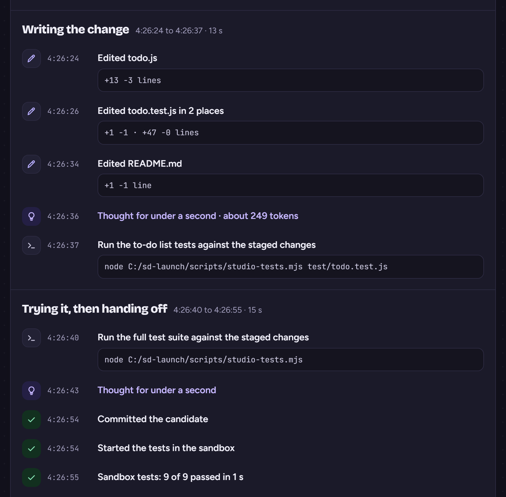
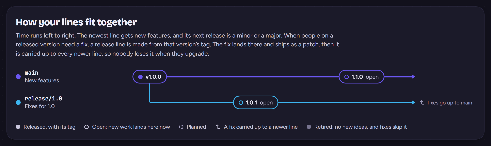

# Studio desk

**You bring the ideas. Studio desk brings the team.**

Describe what you want in plain words. A planner turns it into a plan, you approve it, and a team of AI agents gets to work: building it, testing it and reviewing each other's work before anything goes in. You make the calls. They do the rest.

It works on code in your git repositories, and on anything else you can describe, like writing.

## Why you'll like it

- **It checks its own work.** Every change is tested and independently reviewed before it lands. Work that falls short goes back to be fixed.
- **You stay in charge.** You decide what waits for your approval and what can go ahead on its own.
- **Nothing happens behind your back.** Every step every agent takes is on the record, down to the commands it ran and why anything stopped.
- **It runs on what you already pay for.** Your Claude Code or Codex CLI subscription. No API keys, no per-request bills.
- **It stays on your computer.** No cloud, no hosting. Your code is committed locally and reaches your remote only when you press Push.

## Your team, your way

Studio desk is a pipeline, not a fixed crew. Every project has a team, and every team has roles: a **planner** who turns ideas into work, **agents** who do it, **checks** that run your tests, and a **reviewer** who signs off. You choose who's on the team, which AI tool and model each agent uses, and what they're told. A new install comes with a starting team, so you can jump right in. When a project needs a specialist, like a copywriter or a designer, make one just for that project: it never touches the agents your other projects rely on.

## Get started

You'll need:

- **Windows 10 or 11, macOS or Linux.** Windows has had the most use.
- **[Node.js](https://nodejs.org/) 24 or later.**
- **[Claude Code](https://docs.claude.com/en/docs/claude-code) or [Codex CLI](https://learn.chatgpt.com/docs/cli)**, signed in with a subscription rather than an API key. One is enough.
- **Git**, for code projects.

Then:

1. Download the release and extract it somewhere you'll keep it (or clone the repository and check out `v1.1.0`).
2. Run `npm ci` in that folder, once.
3. Double-click `start-studio.cmd` on Windows, or run `npm start`.
4. Open the link the controller's window prints, in Chrome or Edge. It starts with `http://127.0.0.1:4317/launch/` and signs your browser in, so programs on your computer, an agent's tests included, can't act as you. From then on **http://127.0.0.1:4317** opens it, restarts included.

Keep the controller's window open while you work.

## Your first project

Studio desk opens with two samples to try: a small code library with its tests, and a writing brief for a community garden's new volunteers. Each comes with a team and a few ideas to send, and runs for real on your own sign-in. Or skip them and start your own.

## From idea to done

1. **You send an idea**, with reference files if they help.
2. **The planner breaks it into stories** or steps.
3. **You approve the plan.**
4. **Agents do the work**, each in a copy of its own, side by side, and the tests run.
5. **The reviewer checks it**, pictures of the pages included, and sends back anything that falls short. Want a look yourself first? Try the change in a copy of your own before it lands.
6. **It goes in.** Code is merged into your branch; other work is ready for you to read.
7. **You release it** when the milestone is done.

Agents can ask you a question when a call is yours to make, and pick up where they left off once you answer.

## You make the calls

When something needs you, like approving a plan or accepting a result, it shows up on the project's Today page in plain words, with what to do next. Everything else, like waiting for a busy agent or a usage limit to reset, sorts itself out.

**House rules** decide how much needs you. Every project starts on the recommended ones: you approve every plan, and work that passes its tests and review goes in on its own. Turn that up or down any time.

## Watch it happen

Today shows who's working on what and what shipped. Follow each idea from start to finish, see the whole board at a glance, read every change with its tests and reviews, and open any attempt to see exactly what an agent did and said.

## Bring your own repository

Point Studio desk at a git repository and it works out the rest: what stories may change, what's protected and where the tests are. It runs your tests once before it starts, and adds the project only if they pass.

Your repository needs a clean working tree and tests that run with Node's test runner (`node --test`), or no tests yet. Agents never change your `AGENTS.md`, `CLAUDE.md`, `package.json`, lockfile or tool configuration, and deleting a project never changes your files or branches.

Not code? Start a project without a folder.

## Releases, lines and Push

Send ideas to a release. A milestone like 1.2.0 gathers the ideas you send it; when it's done, Release tags it, drafts its notes for you to approve and moves anything unfinished to the next one.

Need to fix something people already run? Open a patch milestone like 1.1.1. Studio desk makes a release line from that version's tag, lands the fix there and carries it up to every newer line, so nobody loses it when they upgrade. When a line has had its day, retire it.

Push sends a released line and its tag to your remote, with your own git sign-in. It asks every time.

## Safety

Agents run commands on your computer through your CLI:

- **Codex CLI** runs in its own sandbox.
- **Claude Code** has no sandbox on Windows. It runs only the commands you approve in Settings, unless you turn on auto mode, which lets Claude Code decide.

Anything an agent runs has your account's access to your files and network, so **approve narrowly**. A change's tests are kept apart: they run in a disposable copy inside the built-in sandbox, which can change only that copy and can't reach past your computer. On Windows they run as a separate account, which needs a one-time setup from Settings where Windows asks for an administrator; on macOS and Linux your home folder is kept out of their reach. You can choose to run tests without it in Settings, and they then have your account's access.

## Good to know

- **Usage limits:** when your CLI hits its limit, work pauses and picks up again when the limit resets.
- **Stopping:** close the controller any time. Anything cut off mid-step waits for you to check it; nothing is replayed blindly.
- **Your data:** everything lives in the `data` folder next to the app. To back it up, stop the controller and copy the folder. Set `STUDIO_DATA_DIR` or `STUDIO_PORT` to use another folder or port.

## Known limitations

The [release notes](RELEASE-NOTES.md) have the full list. The big ones:

- Tests must run with Node's test runner.
- Claude Code agents without auto mode run only the commands you approve, so one may hand off work it couldn't test; the studio's own checks still run every change's tests.
- Pictures of a story's pages, and trying a change inside the sandbox, work on Windows only for now. Elsewhere a change is tried on your computer, once you've said yes.
- On Windows, keep Studio desk inside your user folder. Installed somewhere else, such as `C:\StudioDesk`, the tests of a change can read its records.
- macOS and Linux have had less use than Windows.

## For developers

Studio desk builds itself with its own pipeline. [AGENTS.md](AGENTS.md) has the development rules, [HANDOFF.md](HANDOFF.md) the current status and what comes next, and [docs/module-contracts.md](docs/module-contracts.md) how it's built. `npm test` runs the full suite without calling any model.

## License

MIT. See [LICENSE](LICENSE).
